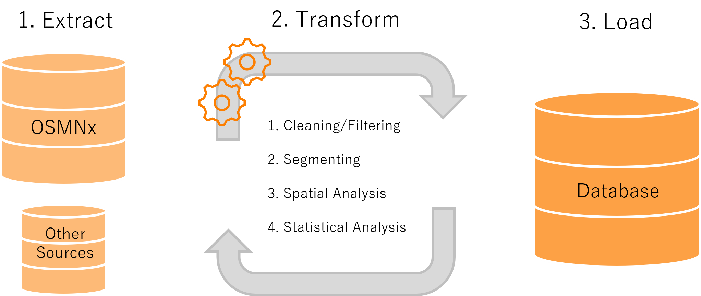
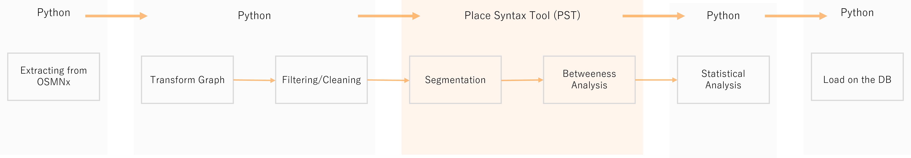

# Generating Multiscalar Street Types Using Context-Aware Angular Betweenness 
[](https://doi.org/10.5281/zenodo.20310363)

**Repository Author**: Flavia Lopes

**Methodology Authors**: Alessandro Araldi, Flavia Lopes, Ioanna Stavroulaki, Giovanni Fusco, Meta Berghauser Pont

### 1. Introduction
This repository documents the workflow for generating multiscalar street network types using the methodology 
developed by Araldi et al. (2026) in *“Street Network Centralities Across (Sub)urban Heterogeneities: A Multi-Scalar 
Context-Aware Approach”*. The approach builds on foundational work by Berghauser Pont et al. (2019), Serra (2014), 
Gil and Serra (2017), and the methodological protocol by [Lopes et al. (2022)](https://github.com/SMoG-Chalmers/multiscalar-street-network-types). The methodology refines the identification of street 
network types by adjusting angular betweenness using two forms of contextual information derived from the surrounding network: 

- **Reached network length:**

$$
CB_{RL,r}(i) = \frac{aB_r(i)}{Rl_r(i)}
$$

- **Reached mean betweenness:**

$$
CB_{MB,r}(i) = \frac{aB_r(i)}{\overline{aB}_{(r;r')}(i)}
$$

This refinement responds to a known limitation of centrality-based measures: their sensitivity to variations in 
network density. In highly consolidated and densely connected urban areas, such as city centres, historical 
districts, and older parts of cities, centrality values are systematically higher. Consequently, these areas tend to dominate the classification of main streets, while structures in lower-density suburban contexts become less visible or are underrepresented.

To address this imbalance, the revised approach reduces the influence of network density in sparsely connected areas.
This results in a more balanced representation of diverse urban morphologies and improves the ability to identify meaningful street network structures across both central and suburban contexts. The method is developed as part of the objectives of the [EMC2 project](https://zenodo.org/communities/emc2/recordsq=&l=list&p=1&s=10&sort=newest), of which it forms part.

### 2. Extracting Transforming and Loading (ETL)
The process of generating street network types follows an ETL (Extract, Transform, Load) workflow. In the extraction phase, non-motorized street network data are retrieved from the OpenStreetMap (OSM) database using OSMnx. In  the transformation phase, the street network is converted into a line-segment network to calculate angular betweenness and reach-based measures. The contextual centrality measures are then derived, after which the resulting maps are simplified, combined, and clustered. Finally, the processed outputs are loaded into the database (Figure 1).



###### Figure 1: ETL process

Different methodologies were used at various stages of the process. Python notebooks were utilized to extract part of the data and to conduct the initial phase of transformation. The Place Syntax Tool (PST) was implemented to generate the segment maps. Finally, Python notebooks were used to perform statistical analysis and load the data into the database (Figure 2).



###### Figure 2: methodologies utilized in the process

### 3. Repository structure: ETL

 - [Extracting](https://github.com/SMoG-Chalmers/multiscalar-street-network-types): The extraction phase follows the same workflow as the original multiscalar-street-network-types protocol. Therefore, the extraction procedures and scripts are available in the repository of the [original method](https://github.com/SMoG-Chalmers/multiscalar-street-network-types) on which the contextual corrections are based. 
 - [Transforming and Load](s1_ContextualCorrectedMeasures): The transforming part of creating the new measures and perform the statistical analysis and load the final data can be find in this folder.

### 4. Required Software and Libraries

### Transforming
#### High-Level Requirements
- [OSMNx](https://osmnx.readthedocs.io/en/stable/) - version 1.2.2 
- [NetworkX](https://networkx.org/) - version 2.8.5
- [QGIS](https://www.qgis.org/) - version 3.28.4
- [PST](https://research.chalmers.se/en/publication/535711) - version v3.2.4-3.2.5
- [Geopandas](https://geopandas.org/en/stable/index.html) - version 0.14.3
- [Pandas](https://pandas.pydata.org/docs/index.html) - version 2.2.1
- [Numpy](https://numpy.org/) - version 1.24.1
- [Matplotlib](https://matplotlib.org/) - version 3.9.0
- [Seaborn](https://seaborn.pydata.org/) - version 0.13.12
- [Scikit-learn](https://scikit-learn.org/stable/) - version 1.1.1
- [Scikit-learn-extra](https://scikit-learn-extra.readthedocs.io/en/stable/) - version 0.30.0
- [Factor analyzer](https://pypi.org/project/factor-analyzer/) - version 0.4.1

##### Low-level Requirements
- [SQLalchemy](https://www.sqlalchemy.org/) - version 3.9.0

### Loading 
#### High-Level Requirements
- [SQLalchemy](https://www.sqlalchemy.org/) - version 3.9.0
- [Geopandas](https://geopandas.org/en/stable/index.html) - version 0.14.3

### 5. Citation 
#### Cite this repository: 
#### APA
Lopes, F. (2026). Multiscalar Context-Aware Angular Betweenness. Spatial Morphology Group (SMoG), Chalmers University of Technology.
#### BibTex
```bibtex
@misc{lopes2026multiscalar,
  author       = {Lopes, Flavia},
  title        = {Multiscalar Context-Aware Angular Betweenness},
  year         = {2026},
  organization = {Spatial Morphology Group, Chalmers University of Technology},
  note         = {Developed within the EMC2-15mincity project},
  url          = {https://github.com/SMoG-Chalmers/multiscalar-street-network-types}
}
``` 

#### Cite the original work:
#### APA
1. Araldi, A., Lopes, F., Stavroulaki, I., Fusco, G., & Berghauser Pont, M. (2026). Street network centralities across (sub)urban heterogeneities: A multi-scalar context-aware approach. Manuscript under review.

2. Berghauser Pont, M., Stavroulaki, G., & Marcus, L. (2019). Development of urban types based on network centrality,
   built density and their impact on pedestrian movement. Environment and Planning B: Urban Analytics and City Science, 46, 1549–1564. https://doi.org/10.1177/2399808319852632

3. Serra, M. L. L. A. (2014). Anatomy of an emerging metropolitan territory: Towards an integrated analytical 
   framework for metropolitan morphology (Ph.D. dissertation).

4. Gil, J., & Serra, M. (2017). street-network-typologies [Software](https://figshare.com/articles/software/street-network-typologies/5044462?file=8534422). Figshare. https://doi.org/10.6084/m9.figshare.5044462.v1

### Acknowledgements
This resource was produced within the emc2 project, which is funded by ANR (France, grant ANR-23-DUTP-0003), FFG (Austria, grant FO999905461), MUR (Italy, grant 2024/0017648) and Vinnova (Sweden, grant 2023-02581) under the Driving Urban Transition Partnership, which has been co-funded by the European Commission.


